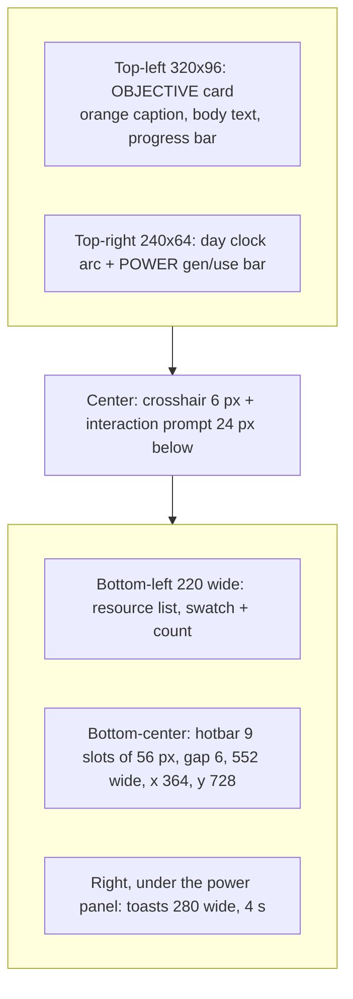

# Project Frontier: Art Direction

Owner: art director session (Opus 5.5). This file owns look, color, shapes, camera feel, typography
and HUD layout. Engine architecture and code belong to the coding agents. Where this file names a
shader constant or function, it describes the visual target, and the code may reach it any way
that works.

## Brief facts this direction serves

From the user's brief (quoted):

- "Aim for a coherent, stylized low-poly sci-fi aesthetic with appealing lighting and colors."
- "Pleasant terrain colors and biome transitions." "Directional sunlight and shadows."
  "Atmospheric fog and sky rendering." "Distinctive buildings and machines."
  "Visible movement on conveyor belts." "Animated robots and machinery."
  "Particle effects for mining and construction."
- "Avoid placeholder boxes wherever possible."
- "The result should look like an intentional indie game rather than an engine debugging
  application."
- Objective example: "constructing and powering a planetary communications tower".

From the coordinator's art brief: teal meadow, amber mesas, lavender fungal biome, ivory and navy
machines, orange accents. Desktop 1280x800, scalable. No external assets.

## Measured facts (repository state on 2026-10-26)

- `src/types.goose`: `Vertex { pos: float3, normal: float3, color: float4 }`. Per-vertex color,
  no textures.
- `src/render.goose` fragment shader: hemisphere ambient, sun with 3x3 PCF shadow (2048 map, ortho
  box 180 m), rim term, exponential fog (`pow(d*fog.w, 1.55)`, density 0.0052, cap 0.96).
  Emissive already exists: `tint.a > 1.0` adds `rgb * (a - 1) * 0.8`.
- Sky shader: horizon/zenith blend by one `daylight` scalar, sun glow and disc, banded planet disc,
  stars. No dusk tint: sunrise and sunset go straight from blue-gray day to night.
- `src/world.goose` `color()`: three climates (meadow, ochre, violet) plus a slope rock blend and
  per-cell value jitter of 0.94..1.06.
- `pkg/gfx/ui.goose` (Goose v2026.3): TrueType fonts load from file or memory and are baked again
  at each UI scale. Nuklear's built-in ProggyClean is available. Drawing has `fill_rect` (rounded),
  `fill_rect_multi_color` (gradients), circles, arcs, triangles, polygons and `draw_text`.
- `samples/data/Roboto-Regular.ttf` (Apache 2.0) ships with the compiler distribution. It is the
  only TTF there.

Assumption: the framebuffer is not sRGB and shader values are display values. All colors below are
display (sRGB) values. If the swapchain becomes sRGB, convert albedos with `pow(c, 2.2)` once,
in one place.

## 1. Look in one sentence

Golden-hour postcard of a soft alien world: warm sun and cool violet shadows, flat-faceted terrain
in teal, amber and lavender, and machines that read as clean ivory-and-navy industrial design with
one hot orange accent each. Machines glow cyan when powered.

Rules:

1. **Flat shading everywhere.** One normal per face (the current `tri()` already does this). Never
   smooth terrain normals: the facets are the style.
2. **No pure black, no pure white.** The darkest value is Navy Ink, the brightest is Ivory or an
   emissive.
3. **Shadows are colored, not dark.** A surface in shadow should look violet-navy, never gray.
4. **Saturation has a budget.** Terrain is mid-saturation. Only orange (interaction and player),
   cyan (power) and ore crystals are fully saturated, so they pop against the land.
5. **The silhouette comes first.** Every machine must be identifiable as a black shape at 40 px.
   Combine primitives; never ship a plain cube for a building.

## 2. Master palette

| Name | Use | Hex | RGB 0..1 |
|---|---|---|---|
| Navy Ink | darkest value, UI panels, machine bases | `#1B2340` | 0.106, 0.137, 0.251 |
| Navy | machine structure, legs, frames | `#2B3A66` | 0.169, 0.227, 0.400 |
| Slate | secondary machine parts, rails | `#4A5578` | 0.290, 0.333, 0.471 |
| Ivory | machine hulls, UI text | `#F2EAD8` | 0.949, 0.918, 0.847 |
| Bone | hull underside, secondary panels | `#D3C8B0` | 0.827, 0.784, 0.690 |
| Signal Orange | accents, player, interaction, chevrons | `#FF7A2F` | 1.000, 0.478, 0.184 |
| Ember | darker orange, hot furnace interior | `#D9502A` | 0.851, 0.314, 0.165 |
| Power Cyan | power, valid placement, robot eye | `#5FF2E0` | 0.373, 0.949, 0.878 |
| Alert Red | no power, invalid, damage | `#FF4D5E` | 1.000, 0.302, 0.369 |
| Solar Blue | photovoltaic surface | `#24366E` | 0.141, 0.212, 0.431 |
| Smoke | smoke and dust particles | `#CFC8D8` | 0.812, 0.784, 0.847 |

Emissive convention (matches the shader): `color.a = 1 + strength`. Use strength 1.5 for cyan
lights, 2.0 for furnace mouths and the beacon, 0.6 for fungal gills at night, 1.0 for robot eyes.

## 3. Terrain and biomes

Map the three existing climates as follows: meadow means Teal Meadow, ochre means Amber Mesas,
violet ("frost") means Lavender Fungal.

| Biome | Role | Hex | RGB 0..1 |
|---|---|---|---|
| Teal Meadow | ground | `#3FA28E` | 0.247, 0.635, 0.557 |
| | low/valley | `#2C7A72` | 0.173, 0.478, 0.447 |
| | high/crest tint | `#7CCFB0` | 0.486, 0.812, 0.690 |
| | slope rock | `#56607A` | 0.337, 0.376, 0.478 |
| Amber Mesas | ground (mesa tops) | `#E2A257` | 0.886, 0.635, 0.341 |
| | strata light | `#F0C98A` | 0.941, 0.788, 0.541 |
| | strata mid | `#C9733D` | 0.788, 0.451, 0.239 |
| | strata dark | `#9C4E36` | 0.612, 0.306, 0.212 |
| Lavender Fungal | ground | `#8A7BC2` | 0.541, 0.482, 0.761 |
| | low/loam | `#5D4F92` | 0.365, 0.310, 0.573 |
| | moss highlight | `#B7A4E6` | 0.718, 0.643, 0.902 |
| | slope rock | `#4B4470` | 0.294, 0.267, 0.439 |
| Shared | exposed soil (dug) | `#6E4B3F` | 0.431, 0.294, 0.247 |
| | deep soil (dug > 2 m) | `#4A3434` | 0.290, 0.204, 0.204 |

Coloring recipe for `world::color()`:

1. **Height tint within the biome:** `t = smoothstep(-6, 14, y - local_mean)`. Use `t` to blend
   low, ground and crest. Valleys are darker and more saturated; crests are lighter.
2. **Slope:** `rock = smoothstep(0.80, 0.62, n.y)`, at most 1.0 (now capped at 0.65). Cliffs
   should be fully rock, because cliffs carry the silhouettes.
3. **Mesa strata:** in Amber, cliff faces (rock > 0.5) take bands instead of rock:
   `band = fract(y / 1.6 + 0.15 * noise(x/20, z/20))`. Below 0.35 is strata light, 0.35..0.7 is
   strata mid, 0.7..1 is strata dark. This one rule makes the mesas.
4. **Transitions:** keep the noise climate, but make the blend band 14 to 20 m wide. The current
   `*9.0` factor is close; use `*6.0`. Add a 4 m jitter by perturbing climate with
   `0.03 * noise(x/9, z/9)`, so borders read as organic, not as contour lines.
5. **Per-face jitter:** keep it, but jitter value ±5% **and** hue slightly. Multiply by
   `(1 + j*0.05, 1 + j*0.03, 1 - j*0.02)` with j in [-1, 1]. Faceted terrain with pure value
   jitter looks noisy; warm-cool jitter looks painted.
6. **Dug surfaces** use exposed soil, deep soil past 2 m below the original height, so digging
   is visible from a distance.
7. **Fake AO:** darken faces in concavities by 15%, for example where height is below the 3x3
   neighbor mean by more than 0.5 m. This grounds props and machines.

Do not add a fourth biome until these three look finished. A salt flat (`#E6ECE8`) is the only
optional extra.

### Vegetation and props, by biome

All flat-shaded. Scatter density goes falloff-to-zero within 2.5 m of buildings.

- **Teal Meadow:** grass tufts (3 thin triangular blades, 0.4..0.7 m, `#56C1A0` and tips
  `#9BE3C4`). "Spire trees": 2 or 3 stacked 6-sided cones, offset and slightly rotated, height
  3..6 m, `#2E8C8E` with ivory seed pods (small octahedra `#F2EAD8`). Basalt boulders:
  jittered icosahedra `#56607A`.
- **Amber Mesas:** barrel plants (6-sided prisms with flat tops, `#D9B25C`, an orange flower
  octahedron on top), hoodoos (stacked frustums, strata-colored, 4..9 m), flat slab rocks.
  Sparse: 30% of meadow density.
- **Lavender Fungal:** giant mushrooms are the biome's landmark. Stem: 6-sided cylinder,
  `#EDE3F5`, 2..7 m, slight lean. Cap: 8-sided flattened cone/dome, `#C9A6F0`, top `#A98BE0`.
  Underside ring of gills `#FF9ED8`, emissive at night only (strength 0.6 * (1 - daylight)).
  Puffballs: small icosahedra `#B7A4E6`, clustered in fives.

### Resources (ore deposits)

Ores are crystal clusters of 3 to 7 elongated octahedra or hex prisms poking out of a basalt
mound, tilted 10..35 degrees. The crystal color must contrast with every biome.

| Ore role | Name | Hex | RGB 0..1 | Emissive |
|---|---|---|---|---|
| primary metal | Ferrite | `#D23C5A` | 0.824, 0.235, 0.353 | 0.3 |
| secondary metal | Aurite | `#FFD447` | 1.000, 0.831, 0.278 | 0.3 |
| crystal or silicon | Glacite | `#8FD3FF` | 0.561, 0.827, 1.000 | 0.5 |

Map these to whatever resource IDs the simulation has. Refined items use the same hue: ingots are
flattened hex prisms in a desaturated version (Ferrite ingot `#A0505E`, Aurite `#D9B04A`,
Glacite wafer `#B8DDF0`). A carried or conveyed raw ore is a 0.25 m octahedron; a refined item is
a 0.3x0.12x0.18 m prism, so the two read differently on belts.

## 4. Sky, fog, sun, shadows

The day needs four moods, not two. Add a `dusk` factor alongside `daylight`:
`dusk = 1 - smoothstep(0.0, 0.35, abs(sun.y - 0.12))`, peaking when the sun is low.

| Key | Zenith | Horizon | Sun color | Fog |
|---|---|---|---|---|
| Noon | `#3E7FB8` (0.243, 0.498, 0.722) | `#BFE0DA` (0.749, 0.878, 0.855) | `#FFF1D6` (1.0, 0.945, 0.839) | horizon |
| Dusk/dawn | `#4A4A8C` (0.290, 0.290, 0.549) | `#FF9E6B` (1.0, 0.620, 0.420) | `#FFB27A` (1.0, 0.698, 0.478) | `#E8A07A` (0.910, 0.627, 0.478) |
| Night | `#0B1026` (0.043, 0.063, 0.149) | `#1E2850` (0.118, 0.157, 0.314) | moon `#8E9BD9` (0.557, 0.608, 0.851) | `#1A2346` (0.102, 0.137, 0.275) |

Blend: `c = mix(night, day, daylight)`, then `c = mix(c, dusk, dusk * 0.8)`.

- **Fog color must equal the sky horizon color** for the same view direction, or the far terrain
  edge shows a seam. Add sun in-scatter: fog color
  `+= sun_color * pow(max(dot(view_dir, sun), 0), 8) * 0.35`. This is the single cheapest
  "atmosphere" win.
- **Fog distance:** about 50% haze at 45% of the streaming radius, at least 92% haze at the
  streaming edge so chunks never pop in. Keep the 0.96 cap only for the sky; terrain at the
  stream edge may go to 1.0. Add height fog in valleys: extra
  `0.25 * exp(-max(y - 2, 0) / 6)` scaled by distance, colored the horizon color. It makes
  valleys read as deep.
- **Sky details:** keep the banded planet; tint it `#E9C8D8` (0.914, 0.784, 0.847) with bands
  `#C9A6C8`, and make it about 1.5x bigger. It is the postcard element, and lavender ties to the
  fungal biome. Stars only above 15 degrees elevation.
- **Sun:** noon elevation about 55 degrees; never overhead, so shadows stay long and readable.
  The current azimuth offset (`z = 0.44`) is good.
- **Ambient:** sky hemisphere noon `#8FB3D9` x 0.40, ground bounce `#6B5A7A` x 0.22 (violet
  bounce keeps shadows colored). Night: sky `#5A5F9E` x 0.30, ground `#2A2448` x 0.15. Night must
  stay playable: terrain in moonlight about 25% of noon brightness, never darker.
- **Shadows:** shadow factor bottoms out at 0.35 of direct light, not 0. With the violet ambient
  this gives navy-violet shadows. Keep 3x3 PCF. For the 180 m ortho box at 2048, every texel is
  8.8 cm, which is fine; use a tighter box (80 m) around the player for sharper machine shadows if
  it costs nothing.
- **Rim:** keep the rim, color it with the current sky horizon color, strength 0.10. It separates
  machines from the terrain at dusk.
- **Tone:** clamp at the end, then apply a slight S-curve: `c = c*c*(3 - 2c)` mixed at 25%. That
  deepens the midtones without crushing.

## 5. Machine design language

Shared rules:

- Hull: Ivory. Structure, base, legs: Navy. Moving or interactive part: Signal Orange (one
  element per machine, not more). Power state: Power Cyan emissive.
- **Every building stands on a foundation pad:** a Navy Ink octagonal or chamfered slab, 0.2 m
  high, 0.15 m larger than the footprint on each side. It grounds the building, hides terrain
  seams and gives a contact shadow.
- **Status light** on every powered machine: a 0.18 m octahedron at the highest point. Cyan
  emissive 1.5 when working; orange 1.0 when idle or missing input; red blinking at 1 Hz when
  unpowered.
- **Primitives to build in the mesh generator:** chamfered box (edges cut at 12% of the
  shortest side), n-gon prism/cylinder (6, 8, 12 sides), frustum/cone, low hemisphere
  (8 sides x 3 rings), octahedron, jittered icosahedron, wedge/ramp. Machines are assemblies of
  these. A chamfered box instead of a box is the biggest step away from placeholder boxes.
- Scale: 1 grid tile = 1 m (adjust if the grid differs; keep the proportions). The player is
  1.8 m tall.

| Machine | Footprint, height | Assembly | Animation |
|---|---|---|---|
| **Lander** (home base) | 4x4, 5 m | Navy Ink octagonal pad. Three angled Navy legs ending in flat discs. Ivory 8-sided frustum body (r 1.8 below, 1.2 above, h 2.2) on top of the legs. Band of Navy Ink windows (8-sided ring) with a cyan emissive strip. Ivory cone nose with an orange ring. Antenna mast with an orange blinking tip. Ivory wedge ramp to the ground. Three Navy engine bells underneath, faint ember glow inside. | Antenna tip blinks every 2 s. Scorch: ground within 5 m darkened 25%. |
| **Miner** | 2x2, 3 m | Navy pad over the deposit. Ivory chamfered housing (1.6x1.0x1.6). A-frame derrick of two Navy beams. Orange drill shaft (8-sided cylinder) with a Navy cone bit. Ivory hopper chute on the output side. | Shaft bobs 0.35 m at 1.5 Hz, bit spins. Ore-colored chips each cycle. |
| **Smelter** | 2x3, 3.2 m | Ivory chamfered body. Large Navy 12-sided furnace drum on one end with a square mouth, emissive Ember 2.0. Chimney: 8-sided cylinder r 0.25, rises 1.6 m above the roof, with an orange band. Small orange port frames at input and output. | Mouth glow pulses ±20% at 0.7 Hz. Smoke puffs from the chimney. |
| **Solar panel** | 2x2, 2.2 m | Navy cylinder post with Ivory collar. A 2x1.6 panel of 2x3 Solar Blue cells (thin boxes) set in an Ivory frame with 0.05 m gaps, so the frame shows as a grid. A thin cyan edge strip shows output. | The panel yaws toward the sun azimuth and tilts toward the sun's elevation, slowly (20 deg/s). At night it stows flat. This sells the day cycle for free. |
| **Power relay** | 1x1, 4.5 m | Tall Navy 4-sided frustum (0.5 to 0.2 m). Ivory crossarm on top. Cyan octahedron insulator (emissive). Wires to linked relays and machines: thin quads in a catenary with 6 segments, sag 8% of the span. Cyan emissive 1.0 when powered, Slate when not. | Insulator brightens briefly every 3 s; optionally a cyan dot travels along the wires. |
| **Conveyor** | 1x1 segment, 0.5 m | Two Navy side rails (0.08x0.25 m) with Ivory top lips. Belt surface `#2A2F45`. Orange chevrons (flat triangles, 0.3 m wide, every 0.5 m) on the belt pointing in the flow direction. Navy end rollers. A short leg every tile. Corners: chamfered, not square. | Chevrons scroll at belt speed, wrapping per segment. **Items ride on top** at the same speed, so motion is legible with or without cargo. |
| **Worker robot** | 0.8 m tall | Hovering: Ivory squashed low-poly egg body (8x6). Navy Ink visor band with a single cyan eye (emissive 1.0). Two short orange antenna stubs. A cyan hover disc under it (emissive, 0.4 m). Cargo sits in a Navy cradle on top. | Hovers 0.3 m, bobs 0.07 m at 2 Hz. Tilts 10 degrees toward travel and banks into turns. Eye blinks every 3..5 s, staggered per robot. |
| **Comms tower** (objective) | 3x3, 18 m | Tallest object in the game, a landmark seen from everywhere. Navy Ink octagonal base 1 m. Four stacked Ivory 6-sided frustum segments, each narrower, with orange rings at the joints. A large Ivory dish on top (low hemisphere shell, tilted 30 degrees up) and a beacon octahedron. | Built in four visible stages (segments appear as progress). Powered: beacon cyan, pulses. **Completed:** a tall cyan beam into the sky (additive, or emissive thin cylinder 0.6 m wide, 120 m) and a ring pulse expanding along the ground every 2 s. This is the win image; spend effort here. |
| **Player** | 1.8 m | Ivory capsule suit, orange backpack and shoulder pads, Navy Ink visor with a thin cyan rim. Orange is reserved for the player among characters, so the player is always the easiest thing to find. | Small walk bob; tool arm points at the mining target. |

Placement ghost: the machine's own mesh, flat unlit Power Cyan at 35% alpha when valid and Alert
Red when invalid. Without alpha blending: flat color at 60% value, pulsing ±15% at 2 Hz, plus a
footprint outline on the ground.

Particles (all small, flat-shaded cubes or octahedra, gravity, 0.4..0.8 s lifetime):
- Mining: 70% ore color, 30% biome ground color, 0.08..0.15 m, burst of 6..10.
- Digging: exposed soil color, burst of 8.
- Construction: cyan sparks (emissive, tiny, upward) plus an Ivory dust ring at the base.
- Smoke: Smoke color, grows 0.2 to 0.7 m while rising 2 m, fades to the fog color.

## 6. Camera

- Third person orbit. Vertical FOV 55 degrees (now 60). The narrower view distorts the low-poly
  shapes less at the screen edges and makes machines look more solid.
- Look target: player position + 1.2 m up. Default: distance 9 m, pitch 32 degrees downward.
  Zoom range 4..28 m on the wheel; pitch range 10..70 degrees.
- **Build mode:** blend over 0.35 s to pitch 50 degrees, distance 16 m. Leaving it restores the
  previous framing.
- Smoothing: exponential, `k = 10/s` for position, `k = 14/s` for yaw and pitch. No smoothing on
  raw mouse look deltas, only on follow.
- Collision: if terrain blocks the eye, pull in along the ray, ease back out over 0.3 s.
- Opening shot: start 30 m away, high, looking at the lander with the sun behind the camera's
  left shoulder, then ease into the default framing over 2 s. The first frame the player sees sells
  the game.

## 7. Typography

- **HUD font:** Roboto Regular, from the compiler distribution (`samples/data/Roboto-Regular.ttf`,
  Apache 2.0). Embed it in the game with `embed_file` (copy it into the repository with its
  license if the build cannot reach the toolchain path).
- **Debug overlay font:** Nuklear's built-in ProggyClean at 13 px (whole-number scales only). The
  monospace bitmap look keeps the debug overlay visually separate from the game UI. Good, keep it.
- Sizes at 1280x800 (multiply by `ui_scale = min(w/1280, h/800)`, bake the atlas at that scale):
  caption 12, label 14, body 16, heading 20, title 30.
- Small labels in UPPER CASE (category names, "OBJECTIVE", "POWER"). Body text in sentence case.
- Text colors: primary Ivory; secondary `#A9B0C8` (0.663, 0.690, 0.784); disabled `#5E6788`
  (0.369, 0.404, 0.533). Accent labels Signal Orange. Numbers about power use Power Cyan.
- On top of 3D (prompts, labels), give text a 1 px Navy Ink shadow offset (1, 1): draw the text
  twice.

## 8. HUD and UI layout (1280x800 reference)

Panel style: fill Navy Ink at 86% alpha (`#1B2340DB`), rounding 6 px, 1 px border `#3A4670`
(0.227, 0.275, 0.439). A vertical gradient (`fill_rect_multi_color`) from `#24305A` at the top to
Navy Ink at the bottom gives panels depth for free. Screen margin 16 px, gap 8 px.

- **Objective card** (16, 16, 320x96): caption "OBJECTIVE" in orange 12 px; the task in 16 px
  Ivory; a progress bar 288x6, track `#2B3A66`, fill orange, rounding 3. Completed step: line in
  secondary color with a cyan check mark.
- **Day and power** (top-right, 240x64): a 40 px arc showing the sun position (arc in Slate, sun
  dot in `#FFD447`, moon dot in `#8E9BD9`). A power bar: generation in cyan, demand marker as an
  orange tick; when demand exceeds generation, the bar turns Alert Red and the "POWER" caption
  blinks.
- **Hotbar** (9 slots of 56x56, gap 6, centered, 16 px from the bottom): slot fill
  `#1B2340CC`, border `#3A4670`, rounding 4. Selected slot: 2 px orange border and raised 4 px.
  Slot number top-left 12 px secondary; count bottom-right 14 px Ivory. Icons are drawn with
  shapes: a machine's icon is its silhouette in Ivory on a Navy disk, with its accent in orange.
  An ore's icon is a diamond (`fill_polygon`, 4 points) in its ore color.
- **Resources** (bottom-left): one row per resource, 22 px high: a 12 px diamond swatch,
  name 14 px secondary, count 16 px Ivory right-aligned.
- **Crosshair:** 3 px Ivory dot with a 1 px Navy Ink ring. On an interactable target, it grows into
  a 14 px open ring in orange. Prompt below: a key chip (rounded rect 20x20, Ivory fill,
  Navy Ink letter) and the action ("Mine Ferrite") in 16 px Ivory with shadow.
- **Build menu** (centered 760x440, opened with the build key): category tabs on the left
  (140 wide: Extraction, Processing, Power, Logistics, Objective), a grid of cards 136x128 on the
  right. Card: icon area 136x72 drawn with shapes, name 14 px, cost chips (diamond + count; a count
  the player cannot afford in Alert Red). Hovered card: orange border. Unaffordable card: drawn at
  40% alpha. The 3D world stays visible behind it (no full-screen dim; dim the backdrop by 30%
  at most).
- **Toasts:** 280x44, slide in from the right over 0.2 s, last 4 s. A 3 px stripe on the left in
  orange (info), cyan (power or completed), red (warning).
- **World-space labels** (machine names on hover, status) fade with distance: full opacity under
  8 m, gone at 20 m.
- **Debug overlay** (toggle): top-left under the objective card or replacing it. ProggyClean 13,
  Navy Ink at 70%, green is not allowed: use cyan for good values, orange for warnings.

## 9. Order of work for the biggest visual gain

1. Terrain recipe (biome values, mesa strata, height tint) and the dusk key in the sky and fog.
2. Fog = horizon color with sun in-scatter; colored, lifted shadows.
3. Chamfered box and the foundation pad; lander, miner and conveyor with scrolling chevrons.
4. HUD panels, hotbar and Roboto text.
5. Robots, particles, comms tower beam.

## 10. Do not

- No textures needed; do not add noise textures to fake detail. Detail comes from facets and
  per-face jitter.
- No saturated pure green (`#00FF00`-like), no gray shadows, no black outlines on 3D objects.
- No more than one orange element per machine; orange means "interactive or moving".
- No UI element touching the screen edge; 16 px margin always.
- Do not mix smooth and flat shading on the same object.

## Critique log

Screenshots from the running game are reviewed here, newest first.

### 2026-10-26, round 4 (final): noon, dusk, night, victory

Status: **art direction approved; no blockers.**

- **Planet: resolved.** It reads as a lit sphere with broad soft bands and a terminator, sits
  between the HUD cards and is no longer cut by the frame. It works at all three times of day; at
  night it is a fine moon.
- **Victory: resolved.** Tower, rings, dish and beam are in the frame; the ground ring pulse
  reads; the banner sits at the bottom center above the key pill and leaves the colony clear.
- **Lighting:** unchanged from round 3, still within targets.

Future notes (not blocking, for later passes):

1. The beam clips to pure white (`#FFFFFF`) because emission 3 saturates every channel. It reads
   as a light, but the cyan identity is lost. Keep the hue: emissive core cyan at 1.2 plus a
   white center line 30% of the width, or clamp the emissive term per channel before the final
   clamp.
2. At noon the planet is darker and more saturated than the sky around it and looks a little
   heavy. Blend it 20% more toward the sky by day (`0.35 + 0.35*d` becomes `0.55 + 0.25*d`, or
   equivalent).
3. Still open from round 3: the ore cluster inside 6 m of the hero camera (red shapes under the
   cargo panel and the hotbar) and the bluer meadow albedo `#389E99`.
4. Not yet seen in a capture: the amber mesa strata, the lavender fungal biome with night-glowing
   gills, conveyor chevrons in motion, the build menu and placement ghosts. Review them in the
   next art pass.

### 2026-10-26, round 3: noon, dusk, night, victory

Capture camera: pitch 0.20 rad, distance 18 m, yaw 0.873, `planet_dir = (-0.744, 0.242, -0.623)`.

Measured (mean of region samples, luminance 0..255):

| Region | Noon | Dusk | Night | Victory | Target noon / dusk / night |
|---|---|---|---|---|---|
| Near ground | `#5B8367` L121 | `#2F3736` L54 | `#1A2733` L37 | L114 | 100..120 / 55..70 / 30..38 |
| Second near region | L122 | L53 | L37 | L114 | |
| Far ground (fogged) | L182 | L96 | L45 | L178 | |
| Fog-to-near ratio | 1.5 | 1.8 | 1.2 | 1.6 | at most 2.0 / 2.0 / 1.6 |
| Lit hull (lander) | L142 | L101 | L63 | L155 | |

Verdict: **lighting accepted.** All three times of day are within target or at its edge. Night
ground is 31% of noon, which matches the §4 floor (25%). The colony reads at night by its pad
rims, lamps, status lights and furnace. Horizon, relief and sky are now in frame, and the colony,
player and ores compose well. This is an intentional indie look.

Night is on target. If the user still finds it too dark in play, raise only the night sky
ambient to `vec3(0.24, 0.26, 0.42)`, about L43; do not touch the other terms.

Still blocking (two items):

1. **The planet reads as a rendering bug.** It is a flat disc with aliased horizontal stripes
   (moire), cut by the top edge of the frame. My round-2 elevation was wrong: at pitch 11.5
   degrees, 14 degrees elevation lands 25 degrees above the screen center, at the top edge.
   - Direction: `planet_dir = (-0.761, 0.122, -0.637)` (elevation 7 degrees, same azimuth).
   - Size: back to the original angular radius (about 5 degrees; the current 1.5x is too
     large in the frame).
   - Shading: reconstruct a sphere normal from the disc
     (`o = (ray - planet_dir) / sin(radius)`, `nrm = o + planet_dir * sqrt(1 - dot(o, o))`) and
     multiply by `0.35 + 0.65 * max(dot(nrm, sun), 0)`. A terminator makes it a body, not a sticker.
   - Bands: 3 broad soft bands, frequency about 1/5 of the current one (`480` to about `90`),
     through `smoothstep(-0.3, 0.3, sin(...))`. No thin stripes.
   - Rim: blend 25% toward the sky horizon color at the outer 15% of the radius.
2. **Victory has no beam in frame.** The tower is cropped above the third ring; neither the dish
   nor the sky beam is visible, so the win image is a white column. The ground ring pulse
   reads well; keep it.
   - Victory capture: pitch 0.06 rad, distance 30 m, the same yaw, with the tower top and at
     least 40 m of beam in the frame.
   - Beam: 1.2 m wide, emissive strength 3, fog no more than 30% on it (it has to be brighter
     than the noon sky).
   - Move the "TRANSMISSION COMPLETE" banner from mid-screen (it covers the colony) to the
     bottom center, just above the key pill (y about 820..900 at 1080p), over the empty
     foreground ground.

Small, not blocking:

- An ore cluster inside 6 m of the camera still shows as large red shapes under the cargo panel
  and the hotbar in all four captures. Exclude scatter within 6 m of the hero camera path, or fade
  it per the round-1 rule.
- The meadow at noon leans olive (`#5B8367`: blue well below green) because of the warm sun.
  Shift the meadow albedo slightly bluer: `#389E99` (0.220, 0.620, 0.600).

### 2026-10-26, round 2: `frontier-noon.png`, `frontier-dusk.png`, `frontier-night.png`

Capture camera: pitch 0.40 rad (23 degrees), distance 25 m, `stream_radius` 112 m.

Measured (display luminance L = 0.2126R + 0.7152G + 0.0722B, 0..255, same pixels in all three):

| Sample | Noon | Dusk | Night | Target noon / dusk / night |
|---|---|---|---|---|
| Near ground, about 25 m | `#487562` L106 | `#0E1619` L21 | `#090E14` L13 | 100..120 / 55..70 / 30..38 |
| Mid ground | `#79B2A6` L165 | `#5F4C42` L79 | `#0F182E` L24 | |
| Fog band / far | `#C5E5E0` L222 | `#C98B6F` L150 | `#19224B` L35 | |
| Lit hull (smelter) | `#989184` L146 | `#3E3435` L54 | `#222333` L36 | |
| Fog-to-near-ground ratio | 2.1 | **7.1** | **2.7** | at most 2.0 / 2.0 / 1.6 |

What improved: noon is now clean. The near ground is teal, groves are gone from the foreground, the
toast wraps, and the key pill and biome panel read well. Dusk and night have the right hues
(salmon fog, navy night), and the emissives (robot hover discs, furnace mouth, status lights,
relay insulators) carry the night frame. Do not change the hues.

Diagnosis: at dusk and at night the ground is 3x to 5x too dark while the fog stays bright, so the
frame splits into a glowing band over a black floor. The causes in `src/render.goose`: the night
ambient (`*0.30`, `*0.15`) is close to zero, the direct term falls to 0.19 at night, grazing sun on
flat ground gives almost no Lambert term, and the S-curve (`lit*lit*(3-2lit)`) crushes the darks
further.

Priority corrections, in order:

1. **Light floor (the fragment shader, values verified by estimate against the targets above):**
   - `sky_ambient = mix(vec3(0.20, 0.22, 0.36), vec3(0.561, 0.702, 0.851) * 0.40, daylight);`
   - `ground_ambient = mix(vec3(0.10, 0.085, 0.17), vec3(0.42, 0.353, 0.478) * 0.22, daylight);`
   - After the ambient mix: `ambient += vec3(0.30, 0.17, 0.14) * dusk * 0.6;` (`dusk` is
     `params.w`). This is warm bounce from the glowing sky, so the dusk foreground is salmon-tinted,
     not black.
   - Wrapped Lambert: `float direct = clamp((dot(n, sun.xyz) + 0.20) / 1.20, 0.0, 1.0);`
     It gives low sun something to light on flat ground; noon is unchanged within 3%.
   - The direct scale `(0.19 + 0.69 * daylight)` becomes `(0.32 + 0.56 * daylight)`. Noon stays at
     0.88; moonlight now casts readable shadows.
   - Tone curve only by day: `lit = mix(lit, lit*lit*(3.0 - 2.0*lit), 0.25 * daylight);`
   - Estimated result: near ground about L40 at night and L69 at dusk, noon unchanged.
2. **Fog curve.** With the camera 25 m out, a 30 m start puts the colony inside the haze ramp, and
   the mid ground already sits at L165. Start at 40 m, use a Gaussian falloff, and put 50% at 0.70 of
   the stream radius (78 m), giving about 91% at the edge:
   - `fog_distance = max(distance_to_eye - 40.0, 0.0);`
     `haze = 1.0 - exp(-pow(fog_distance * fog.w, 2.0));`
   - CPU density: `0.833 / max(0.70 * stream_radius - 40.0, 12.0)`.
   - Valley fog: 0.25 becomes 0.15.
   - Dusk: the sky horizon and the fog use the same dusk mix and color. Use `dusk * 0.6` (now 0.8)
     and `#E8A07A` (0.910, 0.627, 0.478) instead of `#FF9E6B` in both places, so the band is less
     hot and the seam stays invisible.
3. **Night base lights.** The colony disappears at night except for small emissives. Add, all
   emissive and scaled by `(1 - daylight)`:
   - the lander window band from §5 (Navy Ink ring with a cyan strip, strength 1.5);
   - a thin cyan rim strip along the top edge of each foundation pad, strength 0.8;
   - one warm lamp octahedron (`#FFD9A0`, strength 1.5) on the lander mast and on each machine
     roof.
   Machines must read as a lit outpost from 40 m at night; this is the night's postcard.
4. **Capture framing** (gameplay defaults from §6 stay as they are):
   - **Hero capture** (noon, dusk, night): FOV 55 degrees vertical, target player + 1.2 m,
     pitch 0.20 rad (11.5 degrees), distance 18 m. The horizon then sits about 29% below the
     top of the frame. Player in the left third, colony in the right third.
   - **Planet:** move it to elevation 14 degrees: `planet_dir = (-0.744, 0.242, -0.623)` (same
     azimuth as now). Point the camera's horizontal forward at `(-0.77, -0.64)` in x/z
     (`atan2(dx, dz)` about -2.27 rad) so the planet sits at the top center, between the
     objective card and the power card, about 6% below the top edge. With this yaw, the sun at
     noon and at dusk is behind the camera, so the colony is front-lit and its shadows point
     toward the planet.
   - **Gameplay capture:** pitch 0.52 rad (30 degrees), distance 14 m, same yaw.
   - Nothing inside 6 m of the camera (the red crystal cut by the hotbar at the bottom center):
     the camera fade rule from the first critique applies to ore and rocks too.
5. **Smaller noon items:**
   - Grass tufts read as black glyphs (like insects). Use `#56C1A0` blades and `#9BE3C4` tips.
     They must be lighter than the ground they stand on, not darker.
   - The lower-right ground drifts olive (`#627A5E`). Halve the warm part of the per-face hue
     jitter: `(1 + j*0.05, 1 + j*0.03, 1 - j*0.01)`.
   - The 25 m foreground is now empty. Put one small grove (5 trees) or a boulder group in the
     hero frame between the player and the edge of the frame, at 12 to 20 m from the camera.

Acceptance for the next round: the three hero captures at the framing above; near ground within
the target luminance ranges; fog-to-ground ratio within the limits; the planet visible at the top
center; the colony readable at night by its own lights.

### 2026-10-26: `artifacts/frontier-noon.png` (1920x1080, `--demo`, noon, meadow)

Measured (pixel samples of the capture):

| Sample | Captured | Target |
|---|---|---|
| Ground, about 10 m from the camera | `#709781` | Teal Meadow `#3FA28E` lit, about `#4FB09A` |
| Ground, mid distance | `#8DBAAF` | |
| Ground at the top of the frame | `#A1D1C7` | |
| Cast shadow on near ground | `#47635E` | violet-navy, about `#3B4A6A` |
| Tree, lit side / shade side | `#4B7878` / `#253F44` | |
| Foundation pad | `#435360` | Navy Ink, about `#1B2340` lit |

What works: the machines. Ivory hulls, navy pads and a single orange accent read clearly,
chamfers show, and the colony is the most legible thing on screen. Solar panels, relay wires
and the smelter's glowing mouth sell "working base". The HUD panels, Roboto, orange captions,
ore diamonds and the hotbar are on spec. Keep all of this.

Top 3 fixes, in order:

1. **Haze starts at the camera and veils the whole frame.** Ground 10 m away is already
   `#709781`, a gray mint, against the target `#3FA28E`. Every color is lifted toward the fog, so
   there is no depth gradient: near and far are both pale. Fix: no fog in the first 30 m
   (`d = max(dist - 30, 0)`), then the curve from §4 (50% at 45% of the stream radius, at least 92% at
   the edge). After that, the nearest ground must sample within 10% of the spec albedo times
   lighting. Also check the ambient: if lit ground stays pale with fog off, lower the ambient
   (sky term x0.40, ground x0.22) before touching the albedo.
2. **Shadows are gray-green, not violet, and the plain is flat.** The shadow at `#47635E` is the
   lit ground darkened plus fog. Tint the ambient as in §4 (ground bounce `#6B5A7A`, sky
   `#8FB3D9`) so shadows land near `#3B4A6A`. The capture shows no relief, no slope rock and no
   biome edge: it is a flat mint carpet. For the demo seed, put the colony on a gentle rise with a
   valley or mesa edge in view, and lower the camera to pitch about 32 degrees (it is about 50
   now), so the top 15 to 20% of the frame is horizon and sky. The sky and the planet are the
   postcard element, and this frame has none.
3. **Vegetation overpowers the frame.** Identical cone trees are scattered evenly, and the ones
   between the camera and the player are huge in the foreground. Group trees into groves of 5 to 12
   with open meadow between them (density from low-frequency noise, about 60% of the land empty).
   Keep a 12 m clearing around buildings. Vary the scale 0.6 to 1.4 and the color across 3 variants
   (`#2E8C8E`, `#3A9C86`, `#2A7A86`). Fade or hide trees closer than 6 m to the camera when they
   sit between the camera and the player. The yellow-tan blocks (bottom-right, top-right edge)
   read as placeholder boxes: in the meadow, use the hex barrel plant with an orange flower, or
   none.

Secondary (UI):

- The toast is clipped and 70 px of it is empty. Wrap the text to the box width and size the box
  to its lines (44 px for one line, plus 20 px for each more). This is already being fixed.
- The control hints ("B Build, Q Route...") float without backing; put them on a single pill
  panel (Navy Ink 70%, rounding 10) above the hotbar, keys as Ivory chips.
- "0 / 0 Meadow" at the bottom-right is low-contrast text over a rock. Either put it in a small
  panel aligned with the hotbar baseline, or move the biome name into the day/power card.
- The pads read slate (`#435360`), not navy; this resolves together with fix 1.
