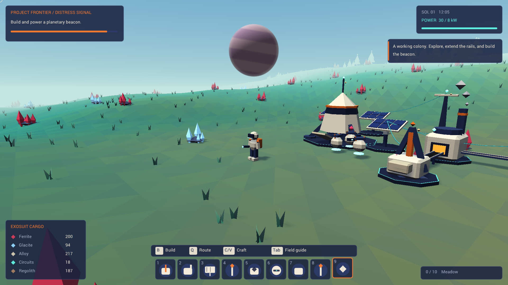

# Project Frontier

A playable third-person exploration and automation game, written in **Goose**. Mine an alien
heightfield world, build a small industrial colony, move cargo over animated rails and with
autonomous robots, and power a planetary beacon to complete the expedition.



## Run

On macOS Apple Silicon, the development executable is `build/frontier`. The macOS application
bundle is `build/Project Frontier.app`; double-click it to play. Neither needs the compiler or
external assets at runtime. The local application is ad-hoc signed, not notarized for distribution.

Build from source with Xcode command-line tools installed:

```sh
./tools/build.sh
./run.sh
```

The bootstrap downloads the official **Goose v2026.3** distribution into ignored `.tools/`.
The Apple Silicon archive is checksum-pinned. No package manager or custom native bindings are
needed. Intel macOS and x86-64 Linux bootstrap paths are provided; only Apple Silicon macOS was
executed and measured here. On other platforms use the official v2026.3 compiler and
`goose build frontier.goose -o build/frontier`.

```sh
./run.sh --resume                   # Restore the last manual save
./run.sh --quality low              # Radius 2, shadows off
./run.sh --quality high             # Radius 4, shadows on
./run.sh --demo                     # A supplied working colony, separate from a new expedition
./run.sh --help
./tools/package-macos.sh            # Rebuild the local .app
```

## Play

Your landing capsule, one solar array and one robot are ready. Starting cargo pays for the
first machines; the beacon requires further mining and production.

| Input | Action |
|---|---|
| WASD, Shift, Space | Walk, sprint, jump |
| Right mouse drag or arrows; wheel | Orbit camera; zoom |
| Hold left mouse over a deposit | Mine red **Ferrite** or blue **Glacite**, within 6 m |
| Hold left mouse over ground | Dig regolith; Shift fills using collected regolith |
| B; 1–8; 9 | Construction cards; select blueprint; return to terrain tool |
| Left click with a blueprint | Place the machine, within 30 m |
| Q on source, then Q on destination | Build a directed cargo rail, up to 24 m, costing 1 regolith |
| E / F | Collect machine inventory / deposit up to 10 of each carried resource |
| C / V | Refine 2 Ferrite into Alloy / make a Circuit from Alloy + Glacite |
| R | Reclaim a nearby structure and its materials/cargo |
| Tab / Escape | Field guide / pause or cancel placement |
| F5 / F9 / F12 | Save / load / screenshot |

Build a **Drill** within 5 m of Ferrite and link it to a **Smelter**. The smelter consumes two
ore units per Alloy. Put solar arrays or relays nearby: power connects automatically through
structures within 14 m, and limited supply causes deterministic brownouts. Solar arrays include
night reserve output. The capsule provides 6 kW.

Build another drill on Glacite, then an **Assembler**. Feed Alloy and Glacite into it for
Circuits. Rails carry one visible item at a time; robots navigate around buildings and can
transport cargo without rails. Connect outputs to the capsule or a depot and collect them with
E. Use F for initial input or craft manually with C/V when useful.

The **Beacon** costs **20 Alloy, 10 Glacite and 8 Circuits**. Supply its 8 kW demand for
45 seconds to transmit. A cyan sky beam marks success; exploration and production continue.
The public-API progression test completes this loop without resource grants.

Saving is explicit. On macOS the default save is
`~/Library/Application Support/Project Frontier/frontier.sav`; Linux uses
`~/.local/share/project-frontier/frontier.sav`. `--save PATH` overrides it. The pause menu has
Save, Load and Save & exit buttons. Saves preserve terrain/deposit changes, machines, networks,
robot paths/cargo, production queues, moving cargo and mission progress. Corrupt saves leave the
current expedition intact. Screenshots go to `artifacts/frontier.png` in the working directory.

## Developer controls and tests

F1 toggles diagnostics; F2/F3 create/destroy 1,000 objects; F4 repeatedly moves through chunks;
F6 adds a robot; F7 builds a resource-network stress fixture; F8 advances the day. O toggles
shadows and +/- changes the streaming radius. The overlay reports frame/simulation/upload time,
entity and chunk storage high-water counts, queued generation work, triangles and collection
pool cells. These are application counters, not a native heap or GPU-driver memory profiler.

```sh
./tools/test.sh                     # Debug-check entity/world/gameplay/persistence tests
./run.sh --playtest --mute          # Real mouse/key events through the ordinary application
./run.sh --stress 200               # Deterministic headless churn and streaming
./tools/test.sh --graphics          # Also run the GPU streaming/churn test
```

The sustained GPU workload runs 2,500 streaming rounds (50,000 frames):

```sh
.tools/goose-v2026.3-macos-arm64/goose build tests/gpu_stress.goose -o build/gpu_stress
./build/gpu_stress
```

See [GOOSE_EVALUATION.md](GOOSE_EVALUATION.md) for exact commands, measured results, unsuccessful
approaches and limits. Raw evidence is in [artifacts/](artifacts/), including the full-factory
stress test, long GPU run and input-driven playtest.

To capture the actual game at exact 1080p without desktop presentation:

```sh
./run.sh --hero --offscreen --frames 180 --time 0.49 --screenshot artifacts/frontier-dusk.png
./run.sh --hero --victory --offscreen --frames 180 --screenshot artifacts/frontier-victory.png
./run.sh --demo --offscreen --frames 1800 --benchmark --mute
```

`--hero` changes capture framing. `--demo` supplies a showcase colony; `--victory` then builds
and simulates charging its beacon. These capture fixtures are separate from ordinary progression.
`--time` is a day phase (0 sunrise, .25 noon, .5 sunset, .75 midnight).

## Implementation and scope

Game rules, ECS, inventories, terrain and mesh generation, collision, pathfinding, UI layout,
save conversion, particles and procedural audio samples are Goose. The official `gfx`, `ui`
and `audio` packages provide SDL3/Metal/Vulkan/D3D platform facilities. **Project-native C/C++:
zero lines.** The repository contains no custom heap allocator.

This is a small colony game: terrain is a deformable heightfield with three biomes, rather than
a volumetric cave system. Distant terrain regenerates deterministically; sparse player edits
and all constructed machines persist. Robots use bounded local A*, not continent-scale route
planning. Physics uses heightfield and circular building footprints. There are no fluids,
enemies, multiplayer, or cloud saves. Performance and memory conclusions apply to the measured
workloads, not arbitrary factory sizes or multi-hour runs.

Architecture is documented in [docs/ARCHITECTURE.md](docs/ARCHITECTURE.md). Visual direction and
actual screenshot critiques by the dedicated Opus 5.5 art director are in
[ART_DIRECTION.md](ART_DIRECTION.md). Roboto's license is in [assets/Roboto-LICENSE.txt](assets/Roboto-LICENSE.txt).
