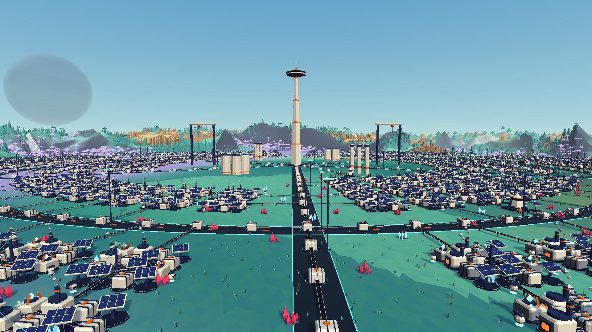
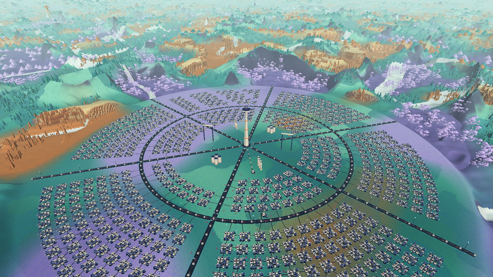
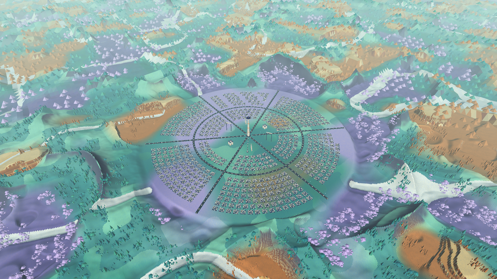

# Project Frontier

A playable third-person exploration and automation game, written in **Goose**. Mine an alien
heightfield world, build a small industrial colony, move cargo over animated rails and with
autonomous robots, and power a planetary beacon to complete the expedition.



## Colony at scale

The live showcase now grows to **12,000 entities across a 624 m campus**: six industrial
sectors around a circular cargo spine, linked by six radial avenues. At full load it contains
**587 production blocks, 1,174 smelters, 1,174 assemblers, 3,522 solar arrays and 2,348 robots**,
plus storage and power infrastructure. Every production block has a directed cargo route to
the central store; these are ordinary game entities with finite feedstock and production queues.
The 72 m communications landmark, utility stacks, tank farms and moving gantries are scenery.



Different sector outlines include a plaza, offset curved rows, gaps in the freight yards and
an open entry gate. The ring closes transport loops instead of repeating a single rectangular grid.



These are unedited 1920×1080 captures of the running game, with the HUD hidden using `--photo`.
Reproduce the avenue, district and landscape views with:

```sh
./run.sh --showcase --load 12000 --survey -10 100 18 0.08 0.51 --time 0.375 \
  --offscreen --photo --frames 180 --mute --screenshot artifacts/colony-metropolis-avenue.png
./run.sh --showcase --load 12000 --survey 140 180 220 0.52 0.75 --time 0.375 \
  --offscreen --photo --frames 180 --mute --screenshot artifacts/colony-metropolis-factories.png
./run.sh --showcase --load 12000 --survey 400 300 500 0.68 0.915 --time 0.375 \
  --offscreen --photo --frames 180 --mute --screenshot artifacts/colony-metropolis-overview.png
```

## Run

On macOS Apple Silicon, the development executable is `build/frontier`. The macOS application
bundle is `build/Project Frontier.app`; double-click it to play. Neither needs the compiler or
external assets at runtime. The local application is ad-hoc signed, not notarized for distribution.

Build from source with Xcode command-line tools, CMake 3.27+ and Git installed:

```sh
./tools/build.sh
./run.sh
```

The bootstrap builds **Goose v2026.3+git.a108677d300c**, an immutable upstream snapshot after
v2026.3, under ignored `.tools/`. The full commit and source-archive SHA-256 are pinned in
`tools/goose-toolchain.env`. This snapshot contains the upstream formatter and `trim_memory()`;
it is not a new official release and does not include unmerged PRs. The first build fetches
the official graphics/audio/UI/physics packages and their native dependencies and can take
several minutes. Later builds reuse them. `FRONTIER_BUILD_JOBS` sets build parallelism (default 4).
The native source build supports macOS and Linux; this snapshot was tested on Apple Silicon macOS.

```sh
./tools/format.sh                   # Official formatter; preserves manual line breaks
./tools/format.sh --check           # Read-only formatting check, also part of the test runner
```

The workspace VS Code settings select this exact compiler and enable Goose format-on-save
through the official extension. Run the bootstrap before opening sources in a fresh checkout.

```sh
./run.sh --resume                   # Restore the last manual save
./run.sh --quality low              # Radius 3, shadows off
./run.sh --quality high             # Radius 8, shadows on
./run.sh --showcase --devtools       # 512 real colony entities, interactive engine inspector
./run.sh --showcase --flight         # Fly above the whole industrial district
./run.sh --survey 465 -854 45 0.12 2.64 # X Z, metres above ground, pitch/yaw in radians
./run.sh --showcase --load 12000 --flight # Six-sector industrial campus
./run.sh --demo                     # The original small working colony
./run.sh --help
./tools/package-macos.sh            # Rebuild the local .app
```

## Play

Your landing capsule, one solar array and one robot are ready. Starting cargo pays for the
first machines; the beacon requires further mining and production.

| Input | Action |
|---|---|
| WASD, Shift, Space | Walk, sprint, jump |
| Right mouse drag or arrows; wheel | Orbit camera; zoom |
| Hold left mouse over a deposit | Mine red **Ferrite** or blue **Glacite**, within 6 m |
| Hold left mouse over ground | Dig regolith; Shift fills using collected regolith |
| B; 1–8; 9 | Construction cards; select blueprint; return to terrain tool |
| Left click with a blueprint | Place the machine, within 30 m |
| Q on source, then Q on destination | Build a directed cargo rail, up to 24 m, costing 1 regolith |
| E / F | Collect machine inventory / deposit up to 10 of each carried resource |
| C / V | Refine 2 Ferrite into Alloy / make a Circuit from Alloy + Glacite |
| R | Reclaim a nearby structure and its materials/cargo |
| Tab / Escape | Field guide / pause or cancel placement |
| F5 / F9 / F12 | Save / load / screenshot |
| G / F10 | Toggle detached survey flight; return to the unchanged suit |
| WASD, Q/E, Shift in flight | Level movement, altitude, acceleration ×4 |
| Right drag / wheel / Home in flight | Look / change flight speed / overview of the base |

Build a **Drill** within 5 m of Ferrite and link it to a **Smelter**. The smelter consumes two
ore units per Alloy. Put solar arrays or relays nearby: power connects automatically through
structures within 14 m, and limited supply causes deterministic brownouts. Solar arrays include
night reserve output. The capsule provides 6 kW.

Build another drill on Glacite, then an **Assembler**. Feed Alloy and Glacite into it for
Circuits. Rails carry one visible item at a time; robots navigate around buildings and can
transport cargo without rails. Connect outputs to the capsule or a depot and collect them with
E. Use F for initial input or craft manually with C/V when useful.

The **Beacon** costs **20 Alloy, 10 Glacite and 8 Circuits**. Supply its 8 kW demand for
45 seconds to transmit. A cyan sky beam marks success; exploration and production continue.
The public-API progression test completes this loop without resource grants.

Survey flight starts about 130 m above the base. With the showcase enabled, Home and
`--flight` frame its campus from 400 m above ground. The suit
stays in place and the colony keeps running. Detailed chunks and distant terrain follow the
camera's view; flying does not teleport the player or edit the save. G returns to the suit.
Flight terrain covers 12–16 km. Visual-only trees and hoodoos continue as reduced individual
meshes to about 900 m, grove canopies to 2.56 km, and silhouettes to 6.14 km. These do not expand
the simulation radius. Background generation and small GPU uploads keep streaming separate
from the frame loop.
Full-detail ground has its own 1,024 m flight radius: 2,176 m across with a two-metre grid,
about 27× the default gameplay window's area. Change **F1 → Controls → Survey detail radius**
from 512 to 2,048 m. Only missing visual tiles stream in as the camera moves.
The HUD shows altitude, speed and controls; the developer panel also has flight buttons and
a 10–300 m/s speed slider. Mouse wheel adjusts that speed, and Shift multiplies it by four.

Saving is explicit. On macOS the default save is
`~/Library/Application Support/Project Frontier/frontier.sav`; Linux uses
`~/.local/share/project-frontier/frontier.sav`. `--save PATH` overrides it. The pause menu has
Save, Load and Save & exit buttons. Saves preserve terrain/deposit changes, machines, networks,
robot paths/cargo, production queues, moving cargo and mission progress. Corrupt saves leave the
current expedition intact. Screenshots go to `artifacts/frontier.png` in the working directory.

## Developer controls and tests

F1 cycles the developer panel through full, compact and closed. The visible **F1 Developer**
button also opens it. Its five tabs are:

- **Overview:** bounded frame history, p50/p95/p99 and CPU time by subsystem.
- **World:** a live chunk map, worker queue/generation timings, horizon LOD and GPU resource counts.
- **Goose:** live/free/retained entity and collection pools, reuse history and a repeatable churn action.
- **Controls:** simulation speed, pause/step, time of day, streaming radius, fog, vegetation,
  shadows, wireframe, robot planning budget and a 32–12,000 entity colony load slider.
- **Inspect:** pin an entity with the Pick button or middle click, inspect inventories, queues
  and links, and follow a linked machine. Destroyed/reused handles are rejected visibly.

The large colony is opt-in with `--showcase` or **Build colony** in Controls. It uses real finite
feedstock, production queues, power, cargo packets and robot routes. Changing its load preserves
resources in an ownership escrow; saving transfers escrow back into an actual store.
Its landmark tower is scenery, so it does not complete the player's mission.

F2/F3 create/destroy 1,000 storage-bearing objects; F4 repeatedly moves through chunks; F6 adds
a robot; F7 builds a resource-network fixture; F8 advances the day. O toggles shadows and +/-
changes the streaming radius. Pool lengths and logical byte estimates are application counters.
OS residency and GPU-driver memory are measured separately; GPU completion waiting is CPU time,
not a hardware utilization percentage or GPU timestamp query.

The Goose tab also has **Release unused stack pages**. It queues `trim_memory()` for the end
of the frame, after temporary geometry/UI scopes return. Large churn, world restore and colony
shrink operations request it automatically. It releases unused main-thread data-stack pages;
retained pool capacity, live values and GPU resources remain allocated. The panel reports the
request's success and duration, not an invented number of freed bytes.

```sh
./tools/test.sh                     # Debug entity/world/gameplay/persistence/telemetry/showcase tests
./run.sh --playtest --mute          # Real mouse/key events through the ordinary application
./run.sh --flight-test --mute       # Real flight keys, streaming, Home and unchanged suit checks
./run.sh --stress 200               # Deterministic headless churn and streaming
./tools/test.sh --graphics          # Also check rendering, LOD lifetimes and actual panel input
./tools/test.sh --stress-graphics   # Sustained GPU streaming/churn workload
```

The sustained GPU workload runs 2,500 streaming rounds (50,000 frames):

```sh
compiler="$(./tools/bootstrap.sh)"
"$compiler" build tests/gpu_stress.goose -o build/gpu_stress
./build/gpu_stress
```

See [GOOSE_EVALUATION.md](GOOSE_EVALUATION.md) for exact commands, measured results, unsuccessful
approaches and limits. Raw evidence is in [artifacts/](artifacts/), including the full-factory
stress test, long GPU run and input-driven playtest.

To capture the actual game at exact 1080p without desktop presentation:

```sh
./run.sh --hero --offscreen --frames 180 --time 0.49 --screenshot artifacts/frontier-dusk.png
./run.sh --hero --victory --offscreen --frames 180 --screenshot artifacts/frontier-victory.png
./run.sh --demo --offscreen --frames 1800 --benchmark --mute
```

`--hero` changes capture framing. `--demo` supplies a showcase colony; `--victory` then builds
and simulates charging its beacon. These capture fixtures are separate from ordinary progression.
`--time` is a day phase (0 sunrise, .25 noon, .5 sunset, .75 midnight).

## Implementation and scope

Game rules, ECS, inventories, terrain and mesh generation, collision, pathfinding, UI layout,
save conversion, particles and procedural audio samples are Goose. The official `gfx`, `ui`
and `audio` packages provide SDL3/Metal/Vulkan/D3D platform facilities. **Project-native C/C++:
zero lines.** The repository contains no custom heap allocator.

The default detailed terrain window is 13×13 chunks (416 m across). Two isolated workers stream
the detailed heightfield; cached LOD rings extend the landscape roughly 2 km on foot and 12–16 km in survey flight. Ridges,
terraced mesas, fungal basins, salt channels, spires and craters share one climate function.
The landing area and its approach to the factory district stay walkable. Fog begins at 140 m
on foot with a 1,600 m visibility scale. Flight blends to 250/3,500 m; the live fog sliders
scale these values. The developer World's counters show distant foliage and effective visibility.

This is a small colony game: terrain is a deformable heightfield with three biomes, rather than
a volumetric cave system. Distant terrain regenerates deterministically; sparse player edits
and all constructed machines persist. Robots use bounded local A*, not continent-scale route
planning. Physics uses heightfield and circular building footprints. There are no fluids,
enemies, multiplayer, or cloud saves. Performance and memory conclusions apply to the measured
workloads, not arbitrary factory sizes or multi-hour runs.

Architecture is documented in [docs/ARCHITECTURE.md](docs/ARCHITECTURE.md). Visual direction and
actual screenshot critiques by the dedicated Opus 5.5 art director are in
[ART_DIRECTION.md](ART_DIRECTION.md). Roboto's license is in [assets/Roboto-LICENSE.txt](assets/Roboto-LICENSE.txt).
