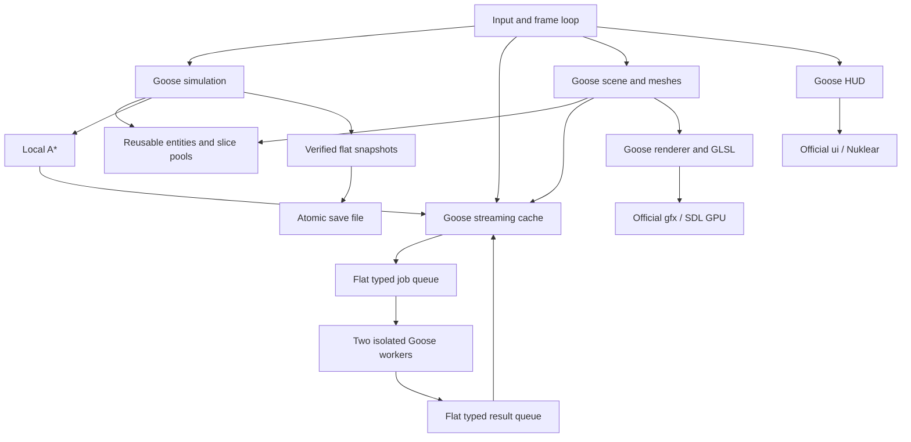

# Engine architecture

Project Frontier is a small, integrated colony game. Goose owns the world, game rules, object
lifetimes, mesh construction, navigation, input policy and save format. The official Goose
packages provide the GPU/window/input interface, immediate-mode text/UI and PCM audio output.

## Modules and boundaries

| File | Responsibility |
|---|---|
| `frontier.goose` | Entry point, CLI, camera, player collision, aiming, controls, frame loop, benchmarks |
| `src/entities.goose` | Reusable entity slots, generational handles, independent inventories/queues/edges |
| `src/world.goose` | Seeded heightfield, sparse edits, bounded streaming cache, isolated generation workers |
| `src/horizon.goose` | Four cached terrain LOD rings, staged replacement and explicit GPU retirement |
| `src/navigation.goose` | Bounded A* and route following over edited terrain and building obstacles |
| `src/sim.goose` | Deposits, mining, construction, recipes, power, resource transport, robots, objective |
| `src/persistence.goose` | Flat verified snapshots and reconstruction of runtime pools |
| `src/render.goose` | Goose mesh primitives, GPU handles, shadow/sky/scene pipelines |
| `src/scene.goose` | Cached terrain/vegetation, machine assemblies, transport visuals, particles |
| `src/hud.goose` | HUD, build cards, help/pause interface, debug counters |
| `src/dev_panel.goose` | Interactive F1 inspector, settings/actions, charts and entity graph navigation |
| `src/telemetry.goose` | Bounded frame history, measured CPU stages and sampled pool counters |
| `src/memory.goose` | Coalesced main-thread page-release requests, explicit frame boundary and result counters |
| `src/showcase.goose` | Finite-input 32–2,000 entity colony, ownership and resource-preserving resizing |
| `src/free_flight.goose` | Detached camera motion and projected streaming focus, independent of player state |
| `src/flight_playtest.goose` | Real injected-input survey-flight integration driver |
| `src/sound.goose` | Procedural sound samples and official audio API calls |
| `src/types.goose` | Shared vertex format and small numeric helpers |

There is no project-defined C allocator, C simulation, native world database or opaque native
entity handle. GLSL shaders are embedded in Goose source and compiled by Goose's `embed_shader`.

## Entity identity and ownership

`ecs::entities` is a `reusable` grow-only pool of fixed-size `Entity` records. A logical entity
owns its slot until destruction. Slot memory remains available for reuse after destruction; pool
length is therefore a storage high-water mark, not a live count.

Cross-entity references are `Handle { slot, generation }` values. `ecs::valid` checks range,
`alive` and generation before access. A monotonically increasing `u32` generation distinguishes a
replacement object from the object previously in that slot. The engine refuses wraparound.

Each entity has three independent slices: inventory, queue and links. Their elements live in
separate Goose `reusable[]` pools. `realloc_slice` may move a run, so the owning entity always
replaces its slice with the returned slice. No system retains an element reference across a run
resize. Item values and entity handles survive such a move.

Destroying an entity removes incoming graph links and targets, returns its three runs, marks the
record dead and returns its slot. Bulk replacement uses `ecs::clear`, which returns all owned
runs without repeatedly scanning the graph. A reusable slot's old bytes are never a valid
logical object merely because its address remains readable.

`Entity.queue` is deliberately shared storage with a kind-specific interpretation: machines keep
production jobs; robots keep signed X/Z waypoint coordinates in hundredths of a metre. The save
validator uses the entity kind when validating it.

## World generation, edits and streaming

The world is an implicit seeded heightfield. A chunk spans 32 metres and stores a 17×17 grid at
two-metre spacing. Terrain generation combines deterministic noise scales with a calm landing
area. Climate noise chooses teal meadow, amber mesas or lavender fungal terrain. Geometry is
flat-shaded; vertex colors encode height, slope, strata, exposed soil and local concavity.

Quality radii 3, 6 and 8 retain square windows of 49, 169 and 289 chunks; the developer slider
also permits radius 2. Missing chunks are requested nearest first. The cache uses reusable
slots and never exceeds 289 slots. A chunk may
be active but not ready while its worker job is outstanding.

Two workers consume flat jobs carrying coordinates, slot, allocation ticket and seed. Workers
return 289 heights and generation CPU time. They do not read mutable main-thread state. At most
eight jobs are outstanding. A returned ticket must still match the active slot: an old result
cannot overwrite a replacement chunk after a teleport.

Shared climate weights drive height, biome names, surface color and vegetation. Value noise
builds ridges, amber terraces, fungal basins and a dry salt channel. Hashed 384 m cells add
spires or craters. Flat landing/district masks override those features; a 40 m wide approach
along the initial camera forward axis connects them, with a smooth 16 m shoulder.

`horizon` adds four non-shadow-casting terrain rings with 8/16/32/64 m base cells. Landmarks
receive local refinement. The center snaps to 64 m cells. An unchanged request does no work;
a changed request builds at most one ring per ordinary frame and swaps all four together.
Center changes during a build are coalesced: the current set finishes, then follows the newest
center. This prevents fast flight from cancelling every partial set. Seed/detail/distance
changes still cancel incompatible work. Fog fades by distance to the active ring center and
its square boundary, rather than assuming the camera is centered inside the rings.
Active and staging sets own at most eight GPU meshes. Skirts and a buried overlap hide LOD
seams. Distant terrain omits fine player edits; detailed chunks preserve and display them.

`world::height` samples the procedural field plus edits independently of residency and follows
the same diagonal split as the mesh. Collision and navigation therefore work before a chunk's
GPU mesh is ready. Negative coordinates use `floor`, including across the origin.

An edit stores a persistent delta at a global grid vertex. A nine-vertex brush deforms the
surface and changes affected chunks' revisions. Revisiting a chunk regenerates its base heights
and reapplies edits. Resource depletion uses a separate sparse coordinate record in `sim`.
These records grow with distinct player changes, rather than with the number of chunk visits.
Current lookups are linear and should be indexed before supporting very large edit histories.

This is a heightfield: there are no caves, overhangs, voxel volumes, fluids or destructible
building meshes. Terrain raising consumes regolith. Mining a resource deposit and digging the
surface are separate interactions.

## Rendering and GPU lifetimes

`scene::cached` owns at most one GPU vertex buffer per chunk slot. An inactive chunk or changed
revision releases the old buffer explicitly. Terrain and static vegetation are rebuilt into a
scope-local Goose vertex array, uploaded, and then the CPU scratch scope ends. GPU handles are
not stored in world saves.

Machines, robots, carried ore, moving rail chevrons, status lights and particles are assembled
into a dynamic triangle batch. Static rail decks, supports and beams share a cached GPU mesh.
Exact building/link/position/generation, terrain-edit and visibility snapshots invalidate that
mesh; unchanged frames do no rail uploads. A separate exact topology cache selects wire
endpoints, while their power colors remain live. Replacement explicitly retires the old rail
buffer. The renderer grows its dynamic GPU buffer geometrically and otherwise
updates it in place. On growth it releases the previous handle. The scene shutdown path releases
cached meshes; renderer shutdown releases pipelines, shadow texture, sampler and dynamic buffer.

The render passes are a directional depth shadow map, a fullscreen procedural sky, and a
depth-tested scene. The scene uses hemisphere ambient lighting, warm sunlight, PCF shadows,
emissive colors, distance/height fog and a small tone curve. The UI renders afterward. Particle
storage is a fixed 256-slot cosmetic ring.

`hud::present` includes a measured v2026.3/Metal compatibility workaround: after rendering both
HUD contexts, it retires the official UI renderer's small index buffer and resets its handle and
capacity. The next official render call recreates it. SDL defers destruction until submitted
draws finish. This adds one small GPU buffer allocation/retirement per frame and depends on the
pinned module's `ui::renderer` fields. No native code or custom allocator is added. UI-only
experiments also bounded memory by releasing an unrelated 16-byte sentinel buffer, so the
evidence points toward native GPU cleanup timing rather than proving a defect in index-buffer
storage itself. Keep the reproducer and rerun memory tests when upgrading the graphics package.

## Detached survey camera

`free_flight` owns its own eye, yaw, pitch, smoothed velocity and bounded speed. It receives
small input values; it cannot mutate player or simulation state. The application maps G/F10,
WASD, Q/E, Shift, mouse look/wheel and Home into this controller. Level movement keeps surveying
predictable, with altitude controlled separately. The camera stays above terrain.

The application projects a bounded look-ahead point onto terrain for detail streaming, LOD
requests and scene visibility. The suit remains at its original location, so construction,
mining and cargo transfer controls are suspended during flight. Production continues. Leaving
flight restores the third-person camera without moving the suit; loading returns to suit mode.
Camera survey state is deliberately not part of the expedition save schema.

## Simulation and progression

Resource IDs are Ferrite, Glacite, alloy, circuits and regolith. Extractors consume nearby
deposits into production queues; smelters turn two Ferrite into one alloy; assemblers consume
one alloy and one Glacite per circuit. Manual recipes bootstrap the colony.

Power components are inferred from structures within 14 metres. Exact topology stamps contain
slot, generation, kind and X/Z position in stable slot order. Each update scans current building
membership against those stamps; only a changed topology rebuilds component membership. Added,
removed, moved, retyped and reused-slot objects invalidate the cache, including direct ECS edits.
`sim::after_load` clears the cache after restoration. Generation and demand are recomputed every
tick, so changing daylight affects allocation without a topology rebuild. Each component assigns
power in stable slot order. Relays extend connectivity.

Logistics links are explicit directed handles between structures within 24 metres. Goose owns
in-flight resource packets; the scene draws their route and motion. A packet owns cargo already
withdrawn from its source. A missing destination triggers a refund, and a missing source does
not prevent delivery. Reclaiming machines returns committed inputs and robot cargo.

Robots select an exporting source and an accepting destination. Their local A* searches a
41×41 two-metre grid, limits expansion to 900 iterations, avoids building corners and steep
steps, and stores the resulting path in the robot's queue. A search rasterizes building
footprints once rather than scanning every building for every grid point. Tests compare the
raster to the original exact obstacle predicate. Two path searches are permitted per simulation
tick. Failed searches retry after a cooldown. Robot jobs prioritize production consumers and the
home lander; lander arrival uses a three-metre clearance. This is local navigation, with no
hierarchical routing or global navmesh.

The objective is to build a communications beacon using 20 alloy, 10 Glacite and eight circuits,
then keep it powered for 45 seconds. Completion enables the beacon's visual signal and leaves
the sandbox available for further expansion.

## Persistence transaction

The save is a versioned envelope containing a flat byte image and FNV-1a checksum. Runtime
`Entity` records contain slices and cannot be serialized directly. `SavedEntity` instead embeds
finished arrays of items and handles. Flat packet, edit, depletion and game-header records are
included. Generated deposits and stress-only objects are omitted; their persistent depletion
records remain.

Loading reads and structurally verifies the envelope, checks magic/version/checksum, verifies
the game image, and validates finite coordinates, counts, kinds, generations and graph handles.
All validation happens before changing the running game. The atomic write API replaces a save
only after writing its replacement.

The optional showcase owns explicit generational handles, not an inferred region of the world.
Resizing removes only those entities, collects queued inputs/cargo into five resource counters
and reuses them on growth. Finite feed stores fund actual recipes; ticks never replenish them.
Before saving, escrow is deposited into a real store. After loading, runtime showcase ownership
is forgotten: restored machines remain normal saved structures, and a later showcase creates
a separately owned fixture. The showcase's rendered tower is a visual landmark rather than a
mission-completing entity. The original expedition progression is unchanged.

Restoration stops/drains world workers, clears live runtime pools, temporarily occupies every
existing or saved entity slot, installs saved records at their original indices, then returns
holes to the freelist. This preserves slot+generation handles regardless of freelist order.
Collection runs are reconstructed in their owning pools. The generation counter never moves
backward. Pending resource packets, including orphaned cargo, are restored and handled by the
normal transport rules. Chunk/GPU caches regenerate from seed and edits.

The schema is explicitly version 1. There is no migration between future schemas, and the
checksum detects accidental damage rather than authenticating a save.

## Reclaiming unused CPU pages

The source-pinned toolchain includes `os::trim_memory()`. `memory::request_trim()` coalesces
requests; `service_request()` executes once near the end of a frame after scene/UI scratch
functions return. Its duration remains inside total frame time. World restoration, large
developer churn, colony shrink and the Goose-tab button request it. It is not a per-frame
automatic call. This API operates on the calling program/thread's data stacks only; it does
not shrink reusable runs, clear their live storage, or reclaim native/GPU handles. Success
means the OS requests succeeded, not that a measured byte count was freed. Existing native
UI-buffer retirement remains in place independently of this feature.

## Diagnostics and scaling boundaries

The F1 panel exposes frame/simulation/mesh/render/UI CPU times, active entities, storage lengths,
loaded chunks, pending jobs, triangles and draw calls. Its frame ring retains 240 samples;
percentiles and expensive live-collection counters refresh at 4 Hz. Pool reuse history is also
bounded to 240 samples. Simulation substeps sum the actual power/production/transport/robot
CPU intervals. UI build and submission are counted once, independently of simulation.
The panel emits action pulses; the application applies mutations after UI construction, so
iterating UI does not mutate the world. Mouse capture prevents mining or building through it.
Benchmark samples are recorded only in
benchmark mode and capped at 16,384 entries. CPU timers surrounding graphics calls do not measure
GPU shader execution time.

Pool lengths expose reuse and fragmentation high-water behavior. Goose's `--stacks` and
`GS_STACK_STATS` expose compiler/runtime region counts; the pinned release does not expose live
committed byte high-water statistics to the HUD. Operating-system process memory measurements
must be recorded separately.

Steady power updates scan entity membership and cached components; topology rebuilds retain an
O(B²) component walk. Graph cleanup scans live owners, deposit lookups scan cached entities, A*
scans its fixed open grid, and moving robots still check building collisions. Spatial and edit
indices, incremental topology rebuilds and a faster search queue remain useful scaling work.

The renderer stress test and production benchmark measure different workloads. The former
repeatedly creates/destroys storage-bearing objects and streams real GPU chunks. The latter
advances 2,155 active entities, including 2,002 structures, 400 production machines and 32 robots,
without rendering. Exact fixture, source/build hashes, percentiles and memory observations are
recorded in `artifacts/` and assessed in `GOOSE_EVALUATION.md`. Neither fixture alone establishes
frame rates for the other workload.
